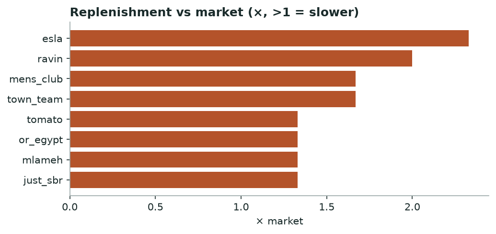

# Khabar — Supply Chain Stress & Brand Health
*Monthly · replenishment, availability, markdown distress & dead stock*

## Decision brief — what to act on
- **town_team** under stress — restocks 1.7× slower than market; only 26% of sellouts return; 453 escalating markdowns; 132 dead-stock lines.
- Benchmark the client's restock lag against the slow brands here. [confirmed · 19 brands, 40,057 cycles]

## Brands that need attention

| Brand | Health | Replen vs mkt (×) | Availability % | Distress markdowns | Dead stock | Training risk |
|---|---|---|---|---|---|---|
| town_team | 🔴 stress | 1.67 | 26.0 | 453 | 132 | watch |
| andora | 🟡 watch | 1.0 | 34.0 | 54 | 0 | healthy |
| esla | 🟡 watch | 2.33 | 5.0 | 0 | 0 | healthy |
| defacto | 🟡 watch |  |  | 50 | 104 | watch |
| khotwh | 🟡 watch | 1.0 | 40.0 | 66 | 32 | healthy |
| lc_waikiki | 🟡 watch |  | 87.0 | 497 | 0 | high |
| ravin | 🟡 watch | 2.0 | 17.0 | 0 | 0 | watch |
| mens_club | 🟡 watch | 1.67 | 5.0 | 12 | 4 | watch |
| rojada | 🟡 watch | 0.33 |  | 116 | 28 | healthy |
| tie_house | 🟡 watch | 1.0 | 33.0 | 0 | 23 | healthy |
| tomato | 🟡 watch | 1.33 | 19.0 | 16 | 18 | healthy |
| zodiac | 🟡 watch | 0.67 | 13.0 | 0 | 17 |  |

_12 other brands read healthy and are omitted for brevity._

*Brands restocking slower than the market median.*

**→ Do:** Brands well above 1× restock materially slower than rivals — a supply constraint a client can be benchmarked against.

---
### Method & confidence
- Health = count of stress flags (slow replen, low availability, distress markdowns, dead stock, high training risk): 3+ = stress, 2 = watch.

*Auto-generated 2026-11-01. Confidence tiers: confirmed / directional / maturing — based on brands covered, days observed, and event volume.*