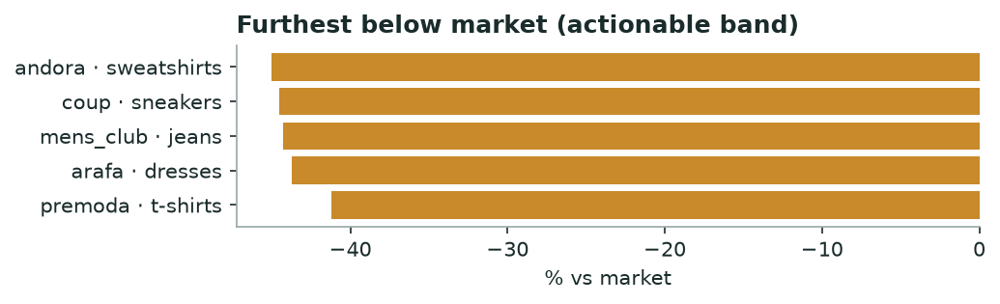

# Khabar — Brand Gap Map
*Monthly · price position, category whitespace, discount timing & honesty*

## Decision brief — what to act on
- Test a price rise: andora / sweatshirts (-45% below peers). [confirmed · 24 brands, 71,169 events]

## Who is leaving money on the table (price position)

| Brand | Category | Brand median | Market median | vs market % |
|---|---|---|---|---|
| andora | sweatshirts | 549.0 | 999.0 | -45.0 |
| coup | sneakers | 499.0 | 899.0 | -44.5 |
| mens_club | jeans | 445.0 | 799.0 | -44.3 |
| arafa | dresses | 450.0 | 799.0 | -43.7 |
| premoda | t-shirts | 229.0 | 389.0 | -41.2 |

*Priced below peers with room to raise.*

**→ Do:** **andora · sweatshirts** sits 45% under the market median — the clearest margin test on the board.

_Flagged to verify (>45% gap — likely a category-mix mismatch, not true underpricing): khotwh·bags, town_team·underwear, zodiac·jackets._

---
### Method & confidence
- Price source: hot + cold (R2 lake, prices only, 45d). Sustained price = median per product over the window; brand median vs market median per category (≥15 products/brand, ≥4 brands). Absolute price, not like-for-like product matching.

*Auto-generated 2026-11-01. Confidence tiers: confirmed / directional / maturing — based on brands covered, days observed, and event volume.*