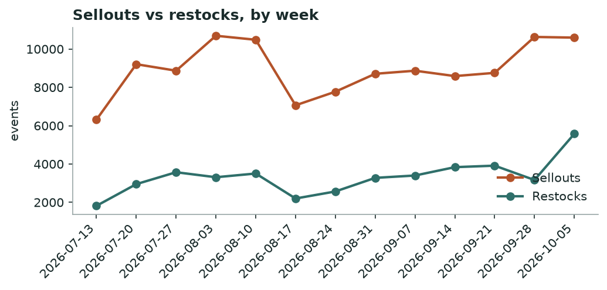
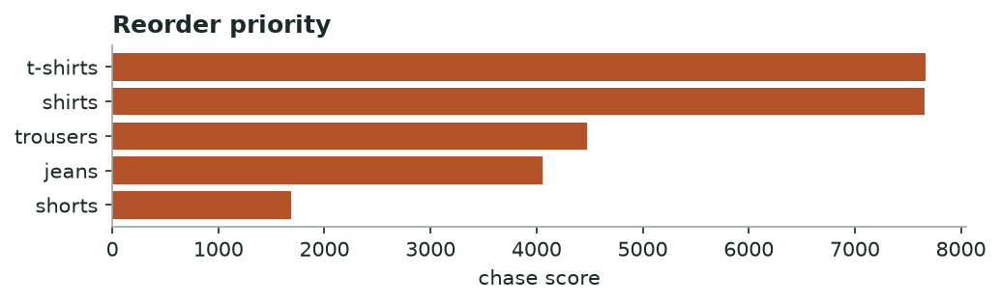

# Khabar — Market Demand & Stockout
*Weekly · witnessed sellouts & restock behaviour, all tracked brands*

## Decision brief — what to act on
- Reorder: t-shirts, shirts, trousers. [confirmed · 22 brands, 30d, 27,403 events]
- Buy deeper in sizes L, XL, M. [confirmed · 17 brands, 737 events]
- Time your move around tomato's t-shirts clearance. [confirmed · 1 brands, 583 events]

## Is the market speeding up or slowing down?

**steady** — -0% week-over-week in sellouts.

*Weekly sellouts vs restocks across all brands.*

## Where demand is outrunning supply — reorder first

| Category | Sellouts | Brands | Restock completion % | Median restock days |
|---|---|---|---|---|
| t-shirts | 8042 | 22 | 30.0 | 2.6 |
| shirts | 8224 | 23 | 35.0 | 3.0 |
| trousers | 4785 | 23 | 34.0 | 2.9 |
| jeans | 4676 | 18 | 36.0 | 2.4 |
| shorts | 1676 | 20 | 34.0 | 3.7 |

*Higher = selling out faster than it comes back.*

**→ Do:** Reorder **t-shirts, shirts, trousers** first — high sellouts with slow, incomplete restock is unmet demand, not noise.

## Sizes that sell out first

Empty while the rest of the run still sits: **L, XL, M**.

## Clearance wave to watch

**tomato** is dumping **t-shirts** (122 SKUs at once).

**→ Do:** Don't discount into their wave — hold and let it pass, or match only if you share the shopper.

---
### Method & confidence
- Velocity = weekly witnessed sellouts vs restocks, all brands. Young series — read direction, not magnitude.
- Chase = sellouts × (1 − restock completion) × restock-lag. Stock-blind brands (DeFacto, Mobaco) and LCW per-size excluded.

*Auto-generated 2026-10-10. Confidence tiers: confirmed / directional / maturing — based on brands covered, days observed, and event volume.*