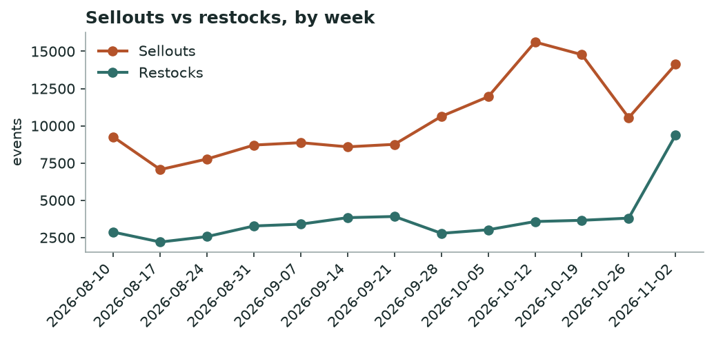
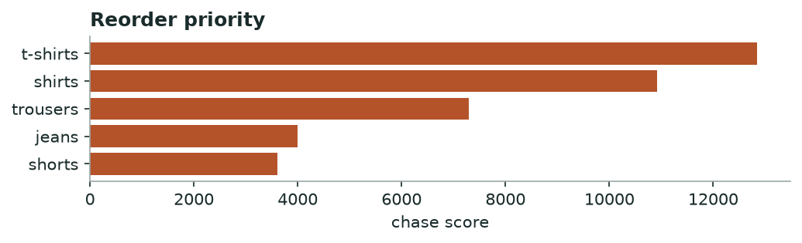

# Khabar — Market Demand & Stockout
*Weekly · witnessed sellouts & restock behaviour, all tracked brands*

## Decision brief — what to act on
- Pull key-item markdowns forward — market clearing faster. [confirmed · 91d, 136,645 events]
- Reorder: t-shirts, shirts, trousers. [confirmed · 21 brands, 30d, 36,202 events]
- Buy deeper in sizes L, XL, M. [confirmed · 19 brands, 2,211 events]
- Time your move around tomato's sweatshirts clearance. [maturing · 1 brands, 27 events]

## Is the market speeding up or slowing down?

**accelerating — market clearing faster than last week** — +34% week-over-week in sellouts.

*Weekly sellouts vs restocks across all brands.*

**→ Do:** Demand is outrunning restocks — protect stock on movers and pull planned markdowns forward before rivals clear first.

## Where demand is outrunning supply — reorder first

| Category | Sellouts | Brands | Restock completion % | Median restock days |
|---|---|---|---|---|
| t-shirts | 11831 | 21 | 24.0 | 3.0 |
| shirts | 9787 | 22 | 22.0 | 3.0 |
| trousers | 7454 | 24 | 32.0 | 3.0 |
| jeans | 4119 | 19 | 32.0 | 3.0 |
| shorts | 3011 | 20 | 29.0 | 4.8 |

*Higher = selling out faster than it comes back.*

**→ Do:** Reorder **t-shirts, shirts, trousers** first — high sellouts with slow, incomplete restock is unmet demand, not noise.

## Sizes that sell out first

Empty while the rest of the run still sits: **L, XL, M**.

## Clearance wave to watch

**tomato** is dumping **sweatshirts** (27 SKUs at once).

**→ Do:** Don't discount into their wave — hold and let it pass, or match only if you share the shopper.

---
### Method & confidence
- Velocity = weekly witnessed sellouts vs restocks, all brands. Young series — read direction, not magnitude.
- Chase = sellouts × (1 − restock completion) × restock-lag. Stock-blind brands (DeFacto, Mobaco) and LCW per-size excluded.

*Auto-generated 2026-11-09. Confidence tiers: confirmed / directional / maturing — based on brands covered, days observed, and event volume.*